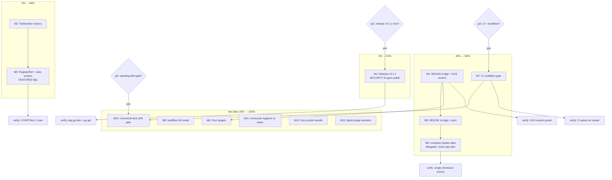

# Pareto Execution Plan — go-legalparty

**Created:** 2026-11-22 19:05 CET · pareto-planning skill (agent, glm-5.3, Crush)
**Inputs:** `TODO_LIST.md` (13 open rows, all verified open this session), `ROADMAP.md`, status reports 1+2 (`docs/status/2026-11-22_16-24_*`, `docs/status/2026-11-22_18-44_*`), architecture diagrams (`docs/architecture-understanding/`).
**Errata:** none — the backlog was built and verified today; no stale rows found (CHANGELOG + code grepped per skill step 0).
**Decision gates carried from report 2:** g/1 release cadence, g/2 CI composition, g/3 drift gate. This plan RECOMMENDS: ship v0.1.1 promptly (the SECURITY.md fix — a misdirected vulnerability-report URL — is live), compose CI fresh from the buildflow gate, build the drift gate. Each gate is marked where it applies; execute only after the owner confirms.

## Goal frame

This library's product IS correctness: checksum edges pinned by vectors, adopted by all three consumers, published truthfully. Customer value = (a) the three fleet consumer repos, (b) future fleet adopters reading pkg.go.dev, (c) billing end-users downstream of invoices/company-master-data.

## Pareto breakdown

### The 1% that delivers 51%: ship v0.1.1

One ~45-minute task publishes everything the audit fixed: the SECURITY.md advisory URL that misdirected vulnerability reports to the wrong repo, the README rows that misdocumented the API (branch/trust classes, FI length, PL rule), the executed examples, and the CHANGELOG. Until tagged, pkg.go.dev shows the v0.1.0 state — including the wrong advisory URL. **Decision-gated: g/1.**

### The 4% that delivers 64%: + pin the untested vectors

`ParseTaxNumber` (3 rejection codes + DE bounds), `RegisterRef` (2 codes), `RequiresRegistryAnchor`/`AllowsLEI` — the only shipped parse paths without vectors. S effort total; ends three PARTIALLY_FUNCTIONAL FEATURES rows. A silent bug in an untested rejection path is the library's worst remaining risk.

### The 20% that delivers 80%: + REGON and CI

- **REGON 9+14-digit**: completes the library's founding mission — ending the fleet's checksum split brains. company-master-data's local copy (the last one) gets deleted after.
- **CI wiring (buildflow as push/PR gate)**: makes every future change gated; turns SECURITY.md's honest "planned" into true; gives Dependabot PRs a verdict. **Decision-gated: g/2.**

### The other 20% to reach 100%

Fuzz targets (parsers are pure functions — ideal fuzz surface) · `buildflow --build-mode full` validation · canonical-facts drift gate (**decision-gated: g/3**) · consumer-repo hygiene (invoices `// indirect`, legalparty-model leftover test) · docs polish (report-1 annotations, AGENTS status-convention line, census routing) · dprint local-plugin decision · recurring Dependabot triage.

## Comprehensive plan — medium granularity (30-100 min each)

Sorted by importance → impact → effort → customer value. Tier: P1 = the 1%, P4 = the 4%, P20 = the 20%, R = the rest.

| #   | Task (30-100 min)                                                                                                                    | Tier | Impact   | Effort | Customer value                                        | Depends on | Gate |
| --- | ------------------------------------------------------------------------------------------------------------------------------------ | ---- | -------- | ------ | ----------------------------------------------------- | ---------- | ---- |
| M1  | Release v0.1.1: CHANGELOG cut, green battery, annotated tag, push, pkg.go.dev verify, scratch `go get` verify                        | P1   | Critical | 45m    | Published SECURITY fix + truthful API docs            | —          | g/1  |
| M2  | Vectors: `TestParseTaxNumber` (required / vat_shape / national_invalid + DE 10-13 bounds + happy path)                               | P4   | High     | 40m    | Correctness assurance on shipped API                  | —          | —    |
| M3  | Vectors: `RegisterRef` (2 codes) + rule methods (5 classes × 2) + flip 3 FEATURES rows                                               | P4   | High     | 35m    | Correctness assurance; honest inventory goes green    | —          | —    |
| M4  | REGON: `Regon` type + `ParseRegon` 9-digit (weights 8-9-2-3-4-5-6-7, remainder 10 → check digit 0 — the anti-NIP edge) + GUS vectors | P20  | High     | 90m    | Fleet consolidation; last split brain ends            | —          | —    |
| M5  | REGON 14-digit + cross-form vectors + docs (README table, DOMAIN_LANGUAGE, AGENTS consumers)                                         | P20  | Med      | 60m    | Complete REGON coverage                               | M4         | —    |
| M6  | company-master-data: delegate to `legalparty.ParseRegon`, delete local copy (repo: company-master-data)                              | P20  | Med      | 30m    | Single checksum source in the fleet                   | M4, M5     | —    |
| M7  | CI: compose + wire buildflow push/PR workflow, first green run                                                                       | P20  | High     | 90m    | Every contribution gated; Dependabot verdicts         | —          | g/2  |
| M8  | Fuzz targets: FuzzParseNIP / VATID / LEI / TaxNumber (+ Regon) + seed corpus + short runs                                            | R    | Med      | 90m    | Robustness against malformed input                    | M4 (Regon) | —    |
| M9  | `buildflow --build-mode full` once + triage                                                                                          | R    | Med      | 45m    | Release-mode confidence                               | —          | —    |
| M10 | Canonical-facts drift gate: script pinning README table rows to code symbols, wired into CI                                          | R    | Med      | 90m    | Mechanically prevents the FI/branch-trust drift class | M7         | g/3  |
| M11 | Consumer hygiene: invoices `go mod tidy` + build; legalparty-model `identifiers_test.go` verdict (repo: both)                        | R    | Med      | 30m    | Fleet hygiene; migration story complete               | —          | —    |
| M12 | Docs polish: annotate report 1 resolved §b/§d; AGENTS `docs/status/` line; census routing decision                                   | R    | Low      | 30m    | Doc honesty for future sessions                       | —          | —    |
| M13 | dprint local-plugin decision + apply (or document acceptance)                                                                        | R    | Low      | 30m    | Cold-run reliability for every contributor            | —          | —    |

Recurring (unscheduled): Dependabot weekly wave triage (~15m/pass, after M7 gives PRs a gate).

## Fine breakdown — max 12 min per task

All medium tasks split; ALL TODOs covered. Order = execution order within each medium task.

| #   | Task (≤12 min)                                                                                         | Parent | Est |
| --- | ------------------------------------------------------------------------------------------------------ | ------ | --- |
| F01 | CHANGELOG: `[Unreleased]` → `## [v0.1.1] - 2026-11-XX` header + date                                   | M1     | 5m  |
| F02 | Green battery: `go test -race`, `docs-gates run`, `buildflow --build-mode dev`                         | M1     | 10m |
| F03 | Annotated tag `v0.1.1` with summarized message                                                         | M1     | 5m  |
| F04 | Push master + tag to origin                                                                            | M1     | 5m  |
| F05 | pkg.go.dev: request refresh, verify v0.1.1 renders (README, SECURITY link target)                      | M1     | 10m |
| F06 | Scratch module: `go get github.com/larsartmann/go-legalparty@v0.1.1` resolves + compiles               | M1     | 10m |
| F07 | `TestParseTaxNumber` table skeleton (name/in/want/wantCode) + t.Parallel                               | M2     | 12m |
| F08 | Happy-path vectors: DE 10/11/12/13-digit forms, separator-stripped, generic country                    | M2     | 12m |
| F09 | Rejection vectors: `tax_number.required`, `vat_shape` (each with expect-message), `national_invalid`   | M2     | 12m |
| F10 | Run suite; fix expectations against real codes; dprint+gates green                                     | M2     | 12m |
| F11 | `TestNewRegisterRef` vectors: happy, `registry_required`, `number_required`                            | M3     | 12m |
| F12 | Rule-method vectors: `RequiresRegistryAnchor` × 5 classes, `AllowsLEI` × 5 classes (incl. sole trader) | M3     | 12m |
| F13 | FEATURES: flip 3 PARTIALLY rows → FULLY_FUNCTIONAL with test evidence; full suite green                | M3     | 12m |
| F14 | `regon.go`: `Regon` type + doc comment (regulation refs, the anti-NIP edge)                            | M4     | 12m |
| F15 | 9-digit weighted checksum kernel (weights 8,9,2,3,4,5,6,7; mod 11)                                     | M4     | 12m |
| F16 | Remainder-10 handling: encodes check digit 0 (opposite of NIP) — isolated + commented                  | M4     | 12m |
| F17 | `ParseRegon`: normalize (reuse `normalizeTaxIdentifier`), length branches, rejection codes             | M4     | 12m |
| F18 | GUS official example vectors (9-digit) + tampered-check-digit rejections                               | M4     | 12m |
| F19 | Run suite; verify every rejection code matches `legalparty.regon.*` naming                             | M4     | 12m |
| F20 | Code review pass: naming, no magic numbers, comment-why style                                          | M4     | 12m |
| F21 | 14-digit form: extended weights + cross-check (9-digit prefix consistency where applicable)            | M5     | 12m |
| F22 | 14-digit vectors + rejections                                                                          | M5     | 12m |
| F23 | Docs: README table row, DOMAIN_LANGUAGE entry, AGENTS consumers note, TODO row removal                 | M5     | 12m |
| F24 | CHANGELOG: REGON entry under new Unreleased                                                            | M5     | 6m  |
| F25 | company-master-data: swap local REGON for `legalparty.ParseRegon`                                      | M6     | 12m |
| F26 | Delete local REGON constants/func; `go mod tidy`                                                       | M6     | 6m  |
| F27 | company-master-data suite green + commit there                                                         | M6     | 12m |
| F28 | Survey sibling CI (go-error-family `.github/workflows/ci.yml`) for reusable shape                      | M7     | 12m |
| F29 | Compose buildflow workflow (push + PR; nix or binary install path decision)                            | M7     | 12m |
| F30 | Push feature branch; first CI run; capture failures                                                    | M7     | 12m |
| F31 | Triage/fix round 1 (lint findings, action versions)                                                    | M7     | 12m |
| F32 | Triage/fix round 2 + merge to master; master green                                                     | M7     | 12m |
| F33 | `FuzzParseNIP` + seed corpus (valid + tampered + separator forms)                                      | M8     | 12m |
| F34 | `FuzzParseVATID` + seeds (DE/NL/AT/PL/generic shapes)                                                  | M8     | 12m |
| F35 | `FuzzParseLEI` + seeds (live records, lowercase, tampered)                                             | M8     | 12m |
| F36 | `FuzzParseTaxNumber` + seeds (DE bounds, VAT-shaped, separators)                                       | M8     | 12m |
| F37 | 30s fuzz run each; triage crashes/panics (must only error, never panic)                                | M8     | 12m |
| F38 | `FuzzParseRegon` (post-M4) + seeds; CHANGELOG fuzz entry                                               | M8     | 12m |
| F39 | Run `buildflow --build-mode full`; capture matrix                                                      | M9     | 10m |
| F40 | Triage full-mode findings (fix or document deliberate non-fix)                                         | M9     | 12m |
| F41 | Enumerate pinned canonical facts (README table rows ↔ code symbols)                                    | M10    | 12m |
| F42 | Script skeleton: facts file + checker (fleet `check-canonical-facts.sh` shape)                         | M10    | 12m |
| F43 | README-row checks wired; deliberate failure demo (red when row drifts)                                 | M10    | 12m |
| F44 | Add gate step to CI workflow; green run                                                                | M10    | 12m |
| F45 | invoices: `go mod tidy` (indirect → direct), build + test green, commit there                          | M11    | 12m |
| F46 | legalparty-model: inspect `identifiers_test.go` — verdict: keep (tests aliases) / dead (row it there)  | M11    | 12m |
| F47 | Annotate report 1 §b/§d resolved items inline (~~...~~ done at <hash>)                                 | M12    | 12m |
| F48 | AGENTS.md: add `docs/status/` snapshot-convention line to Documentation model                          | M12    | 3m  |
| F49 | Census routing: ROADMAP open question or explicit drop; harvest check green                            | M12    | 5m  |
| F50 | dprint decision: local wasm vs accept fetch; apply or document in AGENTS tool gotchas                  | M13    | 12m |

## Execution graph

## Verification contract (every tier)

1%: pkg.go.dev shows v0.1.1 with the corrected SECURITY link; `go get@v0.1.1` compiles in a scratch module.
4%: `go test ./...` green with zero untested rejection paths (`grep -L` on parse functions vs test funcs); FEATURES shows 0 PARTIALLY rows.
20%: GUS vectors pass; `rg -i regon company-master-data/internal` returns only the delegation call; CI badge green on master.
100%: all gates (`docs-gates`, `buildflow --build-mode dev`, `go test -race`) green; this plan's rows reflected in TODO_LIST removals + CHANGELOG entries.

## Verschlimmbesserung guard

No speculative rewrites. M4-M6 touch public API (new `Regon` type): rejection codes follow the frozen `legalparty.<subject>.<cause>` convention; no existing behavior changes. M7/M10 add CI, never weaken gates to go green. Every task ends with the repo verifiably no worse than found (gates green or the task is not done).
