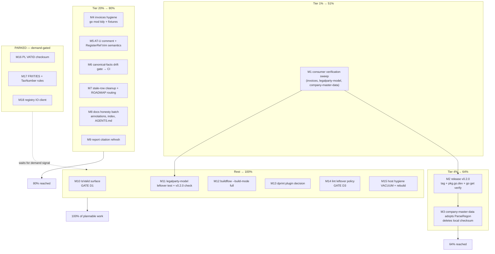

# Pareto Execution Plan v2 — go-legalparty (post five-skill review, verified backlog)

**Created:** 2026-11-22 19:38 CET · pareto-planning skill (agent, glm-5.3-flash, Crush)
**Supersedes:** `docs/planning/2026-11-22_19-05_pareto-execution-plan.md` (v1, 13 todos) —
v1 is annotated, not rewritten; this file ranks what is ACTUALLY still open.
**Inputs:** fresh `TODO_LIST.md` (10 rows, re-read 19:38), `ROADMAP.md`, `CHANGELOG.md`
head, status report `docs/status/2026-11-22_19-26_five-skill-review-session-status.md`
(§f 40 items, §d 5 misses, §g 3 questions), the four HTML reports
(`docs/architecture-understanding/2026-11-22_19-05_modularity.html`,
`2026-11-22_19-10_value-library-deepening.html`, `docs/reviews/2026-11-22_go-legalparty-type-model.html`,
`docs/modularization/2026-11-22_SINGLE_MODULE_VERDICT.html`), v1 plan.
**Git state at planning time:** clean tree @ `78ea3d7`; tests green (`go test ./...` ok).

## Errata — what changed under this plan (skill step 0: verified, not assumed)

| v1 / backlog item                           | Verdict                                       | Evidence                                                                                                         |
| ------------------------------------------- | --------------------------------------------- | ---------------------------------------------------------------------------------------------------------------- |
| v1-M1 release v0.1.1                        | **SHIPPED** `7a95a2a`                         | CHANGELOG `[v0.1.1] - 2026-11-22`                                                                                |
| v1-M2/M3 TaxNumber+RegisterRef+rule vectors | **SHIPPED** `0e57147`                         | CHANGELOG: "Every shipped parse path now carries vectors"                                                        |
| v1-M4/M5 REGON type + vectors               | **SHIPPED** `32a46b8`                         | `regon.go` exists; TODO_LIST row 1 is now STALE (only the cross-repo deletion half remains)                      |
| v1-M7 CI wiring                             | **SHIPPED** `ff773f9` + `3f4bd18` + `10f55df` | `.github/workflows/ci.yml`: race tests, vet, govulncheck, golangci-lint, consumer-import sim, dprint, policy vet |
| v1-M8 fuzz targets                          | **SHIPPED** (committed inside `f3cc1c1`)      | `fuzz_test.go` 146 lines; TODO_LIST row is STALE                                                                 |
| mnd lint warnings                           | **PARTIALLY RESOLVED** `f3cc1c1`              | spec constants named; gochecknoglobals/wsl remain (policy, not code)                                             |
| Five-skill review artifacts                 | **SHIPPED** `78ea3d7`, `b2619db`              | 4 HTML reports + 2 D2/SVG pairs committed                                                                        |

**Why TODO_LIST is not edited by this plan:** concurrent sessions rewrote it three times
today (vectors/REGON/CI landed while this session worked); two of its rows are provably
stale. Stale-row cleanup is task M7 below — one deliberate edit after this plan is
committed, instead of another racing write.

## Goal frame

This library's product IS correctness. Customer value, in order: (a) the three fleet
consumers (`cqrs-htmx/legalparty-model`, `invoices`, `company-master-data`) never silently
break on a validator change; (b) future adopters get a truthful pkg.go.dev face; (c)
billing end-users downstream inherit correct checksums. Everything in this plan serves one
of those three; anything that serves none is parked.

## Pareto breakdown

### The 1% that delivers 51%: cross-repo verification of the shipped tightenings

v0.1.1 carried two consumer-visible behavior changes (Dutch VAT strict shape; AllowsLEI
deny-on-invalid) released **without** consumer verification — the session's biggest miss
(status report §d1). One sweep running all three consumer suites against this HEAD either
confirms safety or catches a real billing break. Nothing else on this list protects real
money-path correctness; this task does. **Gate D2 — recommendation: run it now** (cheap
relative to the risk).

### The 4% that delivers 64%: + release v0.2.0 and finish the REGON pipeline

REGON (new public type → minor bump) is sitting unreleased in `[Unreleased]`; the demand
signal — company-master-data's local checksum copy — can only be deleted after a release
to `go get`. Ship v0.2.0, verify pkg.go.dev, then adopt in company-master-data. That
closes the founding mission of this extraction: one checksum source for the whole fleet.

### The 20% that delivers 80%: + in-repo correctness and doc-honesty hardening

The small bounded batch that prevents recurrence of every failure class observed today:
canonical-facts drift gate (README drift already burned a full session once), the two
noticed-then-dropped code comments/semantics (AT `U` strip, RegisterRef trim), routing
revisit triggers into ROADMAP instead of entombing them in HTML, stale-row cleanup,
consumer hygiene (invoices `// indirect`), report citation refresh + series index,
AGENTS.md reconciliation with today's new reality (CI, regon.go, fuzz).

### The other 20% to reach 100%

Decision-gated: IsValid surface (D1 = the deepening brief's open question), lint leftover
policy (D3). Demand-gated/parked: PL VATID checksum, FR/IT/ES VAT checksums, TaxNumber
jurisdiction rules, registry IO client (second-consumer trigger), GLEIF vector cadence.
Recurring: Dependabot + govulncheck waves. Hygiene: buildflow full mode, dprint plugin
decision, host DB VACUUM + binary rebuild, legalparty-model leftover test.

## Execution graph

## Comprehensive plan — medium granularity (30–100 min each, ALL todos, sorted)

Tier: **1%** / **4%** / **20%** / **R** (rest) / **P** (parked). Sorted by
importance → impact → effort → customer value. Gates: D1 (deepening pick),
D2 (consumer-verify timing), D3 (lint policy).

| #   | Task (30–100 min)                                                                                                                                                                     | Tier | Impact   | Effort | Customer value                                          | Depends                                  | Gate          |
| --- | ------------------------------------------------------------------------------------------------------------------------------------------------------------------------------------- | ---- | -------- | ------ | ------------------------------------------------------- | ---------------------------------------- | ------------- |
| M1  | Cross-repo verification sweep: run invoices + legalparty-model + company-master-data suites against this HEAD; record NL-VAT/AllowsLEI verdicts per repo (repo: all three)            | 1%   | Critical | 60m    | Real billing correctness; closes §d1                    | —                                        | D2 (rec: run) |
| M2  | Release v0.2.0: CHANGELOG stamp, green battery (`go test -race`, buildflow, docs-gates), annotated tag, push, pkg.go.dev + scratch `go get` verify                                    | 4%   | Critical | 45m    | REGON consumable; truthful public face                  | M1                                       | —             |
| M3  | company-master-data: adopt `legalparty.ParseRegon`, delete local checksum copy, run its tests (repo: company-master-data)                                                             | 4%   | High     | 45m    | Fleet single-source checksums; last split brain         | M2                                       | —             |
| M4  | invoices hygiene: `go mod tidy` (stale `// indirect` on go-legalparty), build, NL/PL fixtures re-run (repo: invoices)                                                                 | 20%  | Med      | 30m    | Correct dep graph in a billing repo                     | M1                                       | —             |
| M5  | In-repo correctness batch: AT `U`-strip doc comment; RegisterRef trim-semantics decision + implementation + vectors if behavior changes                                               | 20%  | Med      | 45m    | Contract clarity on two noticed-then-dropped edges      | —                                        | —             |
| M6  | Canonical-facts drift gate: script pinning README/FEATURES table rows to code symbols, wired as CI leg                                                                                | 20%  | Med      | 90m    | Mechanically kills the README-drift class               | —                                        | —             |
| M7  | Backlog truth batch: TODO_LIST stale rows (REGON→done, fuzz→done), route deepening-candidate-2 + modularize-verdict + PL-VATID + GLEIF-cadence triggers into ROADMAP, census routing  | 20%  | Med      | 30m    | Living backlog stops lying                              | —                                        | —             |
| M8  | Docs honesty batch: annotate report-1 resolved §b/§d inline, series index for 4 reports + diagrams, AGENTS.md `docs/status/` convention line + reconciliation (CI/regon/fuzz entries) | 20%  | Low      | 45m    | Future sessions read truth, not history                 | —                                        | —             |
| M9  | Citation refresh: re-verify all file:line refs in the 4 HTML reports against current HEAD; fix drifted ones                                                                           | 20%  | Low      | 30m    | Reports stay citable                                    | —                                        | —             |
| M10 | IsValid surface: LEI/VATID/NIP `IsValid`, TaxNumber `IsValidFor(cc)`, vectors, docs                                                                                                   | R    | Med      | 60m    | One validity idiom for all 7 types (deepening top pick) | —                                        | D1            |
| M11 | legalparty-model: leftover `identifiers_test.go` verdict (aliases vs dead code) + aggregate tests against v0.2.0 (repo: cqrs-htmx)                                                    | R    | Med      | 30m    | Consumer repo stops carrying ghosts                     | M2                                       | —             |
| M12 | `buildflow --build-mode full` once + triage any release-mode findings                                                                                                                 | R    | Med      | 45m    | Release-mode confidence                                 | —                                        | —             |
| M13 | dprint plugin decision: local wasm paths vs accept fetch; apply or document                                                                                                           | R    | Low      | 30m    | Cold-run reliability for contributors                   | —                                        | —             |
| M14 | Lint leftover policy: gochecknoglobals/wsl tolerate-or-suppress with justification blocks in config generation                                                                        | R    | Low      | 30m    | Signal-to-noise in every future lint run                | —                                        | D3            |
| M15 | Host hygiene: buildflow state DB VACUUM (1.10 GB), cache purge (0.6 GB), binary rebuild (be700ae → HEAD)                                                                              | R    | Low      | 30m    | Faster, truthful local gate runs                        | —                                        | —             |
| M16 | PL VATID NIP-checksum inside ParseVATID (length-only today) — regulation pass + vectors + consumer tests                                                                              | P    | Med      | 60m    | Closes the last known message-vs-check gap              | demand: PL VATID billing consumer        | —             |
| M17 | FR/IT/ES VAT checksums + TaxNumber jurisdiction rules (UK UTR, PL NIP-linked), each with official vectors                                                                             | P    | Med      | 100m   | Broader EU billing coverage                             | demand: consumer bills that jurisdiction | —             |
| M18 | Registry IO client extraction from legalparty-model (STACK.md trigger: second consumer)                                                                                               | P    | Med      | 100m   | Registry resolution as owned capability                 | demand: second consumer                  | —             |
| M19 | Recurring: Dependabot weekly wave triage + govulncheck advisory waves (~15m each, after M2)                                                                                           | R    | Low      | 15m    | Deps stay fresh and vetted                              | M2                                       | —             |

## Fine breakdown — ≤12 min per task (ALL todos, execution order)

| #   | Task (≤12 min)                                                                                                       | Parent | Est |
| --- | -------------------------------------------------------------------------------------------------------------------- | ------ | --- |
| F01 | M1: clone/pull invoices, `go build ./... && go test -race ./...` against HEAD via replace                            | M1     | 12m |
| F02 | M1: invoices — grep NL VAT fixtures (`NL\d{9}B\d{2}`), add one letters-in-digits rejection case                      | M1     | 8m  |
| F03 | M1: legalparty-model — `go test -race ./...` + aliases compile check against HEAD                                    | M1     | 10m |
| F04 | M1: legalparty-model — add invalid-class AllowsLEI/RequiresRegistryAnchor expectation test                           | M1     | 8m  |
| F05 | M1: company-master-data — `go test -race ./...` against HEAD                                                         | M1     | 10m |
| F06 | M1: record verdicts (pass/fail per repo) in status report appendix + this plan's errata                              | M1     | 8m  |
| F07 | M2: decide version: v0.2.0 (REGON = new API) — record decision in CHANGELOG stamp                                    | M2     | 5m  |
| F08 | M2: green battery: `go test -race ./...` + `go vet ./...` + buildflow + `docs-gates run .`                           | M2     | 12m |
| F09 | M2: CHANGELOG `[Unreleased]` → `## [v0.2.0] - 2026-11-22`                                                            | M2     | 5m  |
| F10 | M2: annotated tag `v0.2.0` + push master + tag                                                                       | M2     | 5m  |
| F11 | M2: pkg.go.dev propagation check + scratch-module `go get github.com/larsartmann/go-legalparty@v0.2.0` + parse smoke | M2     | 12m |
| F12 | M3: company-master-data — swap local REGON fn for `legalparty.ParseRegon`                                            | M3     | 12m |
| F13 | M3: delete `internal/domain/checksum.go` REGON copy + fix imports                                                    | M3     | 8m  |
| F14 | M3: run company-master-data tests + fix fallout                                                                      | M3     | 12m |
| F15 | M3: update its AGENTS/STACK notes (REGON delegated) + commit                                                         | M3     | 8m  |
| F16 | M4: invoices — `go mod tidy`, confirm indirect marker gone                                                           | M4     | 5m  |
| F17 | M4: invoices — run NL/PL VAT fixture tests                                                                           | M4     | 8m  |
| F18 | M4: commit + push invoices hygiene change                                                                            | M4     | 5m  |
| F19 | M5: AT `U`-strip doc comment in ParseVATID (regulation source: AT UID form)                                          | M5     | 8m  |
| F20 | M5: write RegisterRef trim-semantics decision note (reject-untrimmed vs normalize-on-validate)                       | M5     | 10m |
| F21 | M5: implement the decision + adjust `TestNewRegisterRef` vectors                                                     | M5     | 12m |
| F22 | M5: green battery + commit                                                                                           | M5     | 8m  |
| F23 | M6: write `check-canonical-facts.sh` (README/FEATURES rows ↔ code symbol greps)                                      | M6     | 12m |
| F24 | M6: extend to VAT lengths table, legal-form class list, REGON weights row                                            | M6     | 12m |
| F25 | M6: add CI job step calling the script; prove it fails on a seeded drift                                             | M6     | 12m |
| F26 | M6: prove it passes on clean tree; wire into push/PR workflow                                                        | M6     | 10m |
| F27 | M7: TODO_LIST — remove REGON row + fuzz row (both shipped), record in CHANGELOG                                      | M7     | 8m  |
| F28 | M7: ROADMAP — add "jurisdiction rule seam" row (deepening candidate 2 trigger)                                       | M7     | 5m  |
| F29 | M7: ROADMAP — add modularize-verdict revisit triggers row                                                            | M7     | 5m  |
| F30 | M7: ROADMAP — add PL VATID checksum row + GLEIF vector cadence row                                                   | M7     | 8m  |
| F31 | M7: route fleet-census item (report-1 §f/23): ROADMAP row or explicit drop                                           | M7     | 8m  |
| F32 | M8: annotate report-1 (16-24) §b/§d items inline with done-at verdicts                                               | M8     | 12m |
| F33 | M8: add series index (README or index section) to docs/architecture-understanding/                                   | M8     | 8m  |
| F34 | M8: AGENTS.md — add docs/status/ snapshot-convention line                                                            | M8     | 5m  |
| F35 | M8: AGENTS.md — reconcile Commands/repo conventions with CI workflow, regon.go, fuzz_test.go                         | M8     | 12m |
| F36 | M8: green battery (docs-gates!) + commit                                                                             | M8     | 10m |
| F37 | M9: grep each report for `identifiers.go:`/`taxnumber.go:`/`legalform.go:` refs                                      | M9     | 8m  |
| F38 | M9: re-verify each against current HEAD; edit drifted line numbers                                                   | M9     | 12m |
| F39 | M9: re-render check (SVGs unchanged?) + commit                                                                       | M9     | 8m  |
| F40 | M10: implement `LEI.IsValid` / `VATID.IsValid` / `NIP.IsValid` (Parse-and-discard bodies)                            | M10    | 12m |
| F41 | M10: implement `TaxNumber.IsValidFor(cc)`                                                                            | M10    | 8m  |
| F42 | M10: vector tests for the four methods (valid, invalid, zero value, wrong country)                                   | M10    | 12m |
| F43 | M10: README + DOMAIN_LANGUAGE + FEATURES rows; green battery; commit                                                 | M10    | 12m |
| F44 | M11: read legalparty-model's leftover `identifiers_test.go`; verdict aliases-vs-dead                                 | M11    | 10m |
| F45 | M11: delete dead code or annotate; run its suite against v0.2.0                                                      | M11    | 12m |
| F46 | M12: `buildflow --build-mode full` run                                                                               | M12    | 12m |
| F47 | M12: triage findings + record baseline in AGENTS.md gotchas                                                          | M12    | 12m |
| F48 | M13: try `BUILDFLOW_DPRINT_PLUGINS` local-wasm path from preflight hint                                              | M13    | 12m |
| F49 | M13: apply config change or document acceptance in AGENTS.md; kill the preflight WARN                                | M13    | 10m |
| F50 | M14: decide policy per rule (mnd done by f3cc1c1; gochecknoglobals: two tables = data; wsl: style)                   | M14    | 10m |
| F51 | M14: encode suppressions with justification (buildflow-native config route, never hand-edit list)                    | M14    | 12m |
| F52 | M15: `sqlite3 ~/.local/state/buildflow/buildflow.db VACUUM` + cache purge                                            | M15    | 8m  |
| F53 | M15: rebuild buildflow (`nix build . && nix run .#reinstall`) + PATH check                                           | M15    | 12m |
| F54 | M16–M18: no execution now — each carries its demand trigger; verify triggers are in ROADMAP (F28–F30)                | P      | —   |
| F55 | M19: first Dependabot wave triage after v0.2.0 + calendar note                                                       | M19    | 10m |

_(55 fine tasks; every medium task M1–M19 covered, every open TODO_LIST/ROADMAP row and
session finding mapped. Total fine effort ≈ 8.5h; medium ≈ 10.5h with overhead.)_

## Gates (owner decisions this plan cannot make itself)

| Gate | Question                                                             | Recommendation                                                             |
| ---- | -------------------------------------------------------------------- | -------------------------------------------------------------------------- |
| D1   | Implement the IsValid surface now (M10) or hold for consumer demand? | Implement — behavior-additive, designed, pinned                            |
| D2   | Consumer verification now (M1) or accept fast-release risk?          | Run M1 first — it gates the release (M2)                                   |
| D3   | Lint leftover policy (M14): tolerate or suppress with justification? | Suppress gochecknoglobals with "data tables" justification; keep wsl as-is |

## Relationships

- v1 plan `2026-11-22_19-05`: superseded; its M1/M2/M3/M4/M5/M7/M8 shipped (see errata),
  its M6/M9–M13 re-appear here as M3–M13 with fresh evidence.
- Status report `2026-11-22_19-26`: §d1 → M1; §f items → M1–M19; §g questions → gates
  D1–D3.
- Deepening brief `2026-11-22_19-10`: candidate 1 → M10 (gate D1); candidate 2 → F28.
- Modularize verdict `2026-11-22`: revisit triggers → F29.
